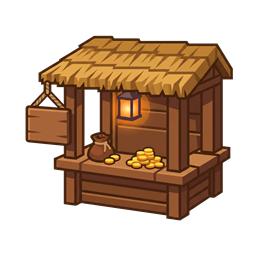

<p align="center">
  
</p>


<h1 align="center">SDM Shop 2</h1>

<p align="center">
  
  
</p>

<p align="center">
  <a href="https://www.curseforge.com/minecraft/mc-mods/sdm-shop-2"></a>
</p>

<p align="center">
  <a href="https://discord.gg/TEUrpKJynj"></a>
</p>


**SDM Shop 2** is a full rewrite of the original SDM Shop mod for Minecraft 1.20.1.
The project is currently in **Beta**: the core shop flow is usable, but the mod should still be treated as a beta while dedicated-server and cross-loader testing continues.

SDM Shop 2 is built around an Entity Component System (ECS): shops and offers are small entities composed from reusable components such as costs, rewards, conditions, limits, categories, promos and render flags.

## Current Status

- **Version:** Beta
- **Minecraft:** 1.20.1
- **Loaders:** Fabric and Forge through Architectury
- **UI:** UniGUI-based custom shop UI
- **Storage:** JSON by default, with MongoDB and custom repository support available through config

## Key Features

### ECS Shop Model

Shop data is component-driven instead of being hardcoded into one rigid offer class.

Registered shop components currently include:

- **Costs:** money/currency cost components with grouped payment options.
- **Rewards:** item rewards, money rewards, command rewards and script rewards.
- **Conditions:** script conditions, cooldown conditions and limiter-backed checks.
- **Categories:** catalog/category components and shop category containers.
- **Limits:** world/player/offer purchase limit tracking with client synchronization.
- **Promos:** time-based, weekly-time, cooldown and externally triggered promos.
- **Promo effects:** discounts and price modifiers with priority ordering.
- **Misc:** names, render hiding, offer containers and shop containers.

### Server-Authoritative Purchase Flow

Purchases are processed on the server by a single transaction processor:

1. Validate input and script pre-purchase hooks.
2. Check conditions and purchase limits.
3. Calculate final prices on the server, including active promo effects and event hooks.
4. Verify every payment source before charging.
5. Charge costs with rollback support if a later cost or reward fails.
6. Grant rewards.
7. Record limiter/cooldown state and sync affected client data.

The client can preview and request prices, but the final price and transaction result come from the server.

### Shop UI

The current UI includes:

- Category tabs with an always-available **All** category.
- Offer panel with search, advanced currency filtering, category filtering and sorting.
- Favorite offers, rendered before regular offers.
- Purchase modal with item preview, quantity input, min/max controls, total price display and client-only success/failure sounds.
- Toast notifications rendered in an overlay above the shop UI.
- Refresh events for currencies, prices, categories, offers and open purchase modals.
- A style/render abstraction (`WidgetRender`) for replacing default renderers.

### In-Game Editor

SDM Shop 2 includes an in-game editor foundation:

- Shop and currency draft sessions.
- Component selection menu with search, favorites and category sorting.
- Component configuration widgets generated from component metadata.
- Editor history persisted in the client cache.
- Guardrails for protected/required components.
- Save/reset flow for shop and currency changes.

### Client Cache

The client has a generic JSON-backed key-value cache for UI data such as:

- favorite offers/components;
- editor history;
- persistent editor sessions.

Values are stored as `JsonElement` and decoded lazily through `FieldCodec`, so new cached data can be added without changing the cache file format.

### Default Shop Generator

A default `sdm:default` shop can be generated automatically for fresh installs. It includes starter item-currency setup and categories such as resources, blocks, farming/food, utility, redstone, rares and exchange.

### Scripting and Events

The shop exposes both Java events and script-facing hooks:

- shop load;
- price calculation;
- before purchase;
- after purchase;
- purchase failed;
- script conditions;
- script rewards;
- externally triggered promos.

KubeJS and CraftTweaker integration classes are present in the common codebase.

### Storage

The shop config supports these storage modes:

- **JSON** — stores shop data under `config/sdm/shop/...`.
- **MongoDB** — stores data in MongoDB and supports multi-server synchronization concepts.
- **CUSTOM** — allows a custom repository implementation.

## Commands

Admin commands currently include:

```text
/sdm_shop create_shop <shop_id>
/sdm_shop open_shop <targets> <shop_id>
/sdm_shop reload shops
/sdm_shop limiter sync
/sdm_shop limiter reset world <shop_id> <offer_id>
/sdm_shop limiter reset player <target> <shop_id> <offer_id>
/sdm_shop limiter reset offer <shop_id> <offer_id>
```

Development-only debug commands are registered only in a development environment.

## Tech Stack

- [Architectury](https://architectury.dev/) — common Fabric/Forge architecture.
- [UniGUI](https://github.com/DeusSixik/UniGui) — retained-mode UI framework and rendering base.
- [Caffeine](https://github.com/ben-manes/caffeine) — high-performance caching utilities.
- [Yaml Config](https://github.com/Tuinity/YamlConfig) — config serialization.
- MongoDB Java Driver — optional MongoDB-backed storage.
- Optional scripting integrations for KubeJS and CraftTweaker.

## Beta Notes

This rewrite is already usable for testing and early server setups, but it should be released as beta until more real-world coverage is collected for:

- dedicated server startup and shop opening;
- client/server currency synchronization;
- item-currency payments;
- stored/virtual currency payments;
- limiter synchronization after purchases;
- promo activation and expiration;
- editor save/reset flows;
- Fabric and Forge parity.

## Why the Rewrite?

The original SDM Shop existed for years and accumulated a lot of legacy code. SDM Shop 2 replaces that foundation with a component-based architecture, cleaner serialization, a modern UniGUI UI and a more controlled server-side transaction pipeline.

---

Developed with ❤️ by Sixik
